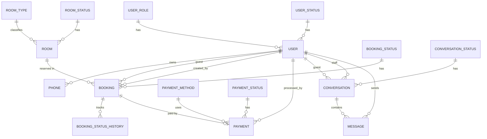

# Hotel Booking API

Secure, role-based backend for a hotel booking platform. It exposes a REST API, 
a GraphQL API and a Socket.IO real-time channel on top of a single PostgreSQL 
database, sharing one service layer, one validation layer and one authentication mechanism.

[](./LICENSE)

## Table of Contents

1. [Overview](#overview)
2. [Features](#features)
3. [Technology Stack](#technology-stack)
4. [Architecture](#architecture)
6. [Getting Started](#getting-started)
7. [Configuration](#configuration)
8. [Database](#database)
9. [Authentication and Authorization](#authentication-and-authorization)
10. [REST API Reference](#rest-api-reference)
11. [GraphQL API Reference](#graphql-api-reference)
12. [Real-Time Chat (Socket.IO)](#real-time-chat-socketio)
13. [Error Handling](#error-handling)
14. [Rate Limiting](#rate-limiting)
15. [Security Notes](#security-notes)
16. [Available Scripts](#available-scripts)
17. [Testing with Postman](#testing-with-postman)
18. [Roadmap](#roadmap)
19. [Contributing](#contributing)
20. [License](#license)

---

## Overview

The Hotel Booking API manages users, rooms, bookings, payments and a staff-to-guest 
support chat. The data model covers the complete booking domain; the HTTP and 
real-time surface currently implemented covers authentication, user management, 
conversation management and encrypted messaging.

Design goals:

- **One business layer, several transports.** REST controllers, GraphQL resolvers and Socket.IO handlers are thin adapters over the same service classes (`UserService`, `AuthenticationServices`, `ConversationService`, `MessageService`).
- **Stateless and cookieless.** Clients authenticate with a short-lived JWT sent as a Bearer token. The token is rotated on every authenticated request.
- **Defense in depth.** API key, JWT verification, role checks, resource-level authorization, input validation, rate limiting and encryption of message bodies at rest.
- **Consistent contracts.** The same Joi schemas validate REST bodies, GraphQL inputs and socket payloads.

## Features

- REST API versioned under `/api/v1`.
- GraphQL API (Apollo Server 5) with the same authorization matrix as REST.
- Real-time staff-guest chat over Socket.IO, authenticated with the same JWT.
- Role-based access control with three roles: `Administrator`, `Staff`, `Guest`.
- Resource-level authorization (participants-only access to conversations and messages).
- AES-256-GCM encryption of message bodies at rest, with versioned payloads for key rotation.
- JWT rotation on every authenticated request (`X-Access-Token` header).
- Brute-force protection on login and password reset (per IP and per account).
- Request validation with Joi, driven by regular expressions that mirror database constraints.
- Database migrations and seeders managed with Sequelize CLI.
- Docker Compose setup for PostgreSQL and pgAdmin.

## Technology Stack

| Concern | Technology |
| --- | --- |
| Runtime | Node.js (ES modules) |
| HTTP framework | Express 5 |
| GraphQL | Apollo Server 5, `@as-integrations/express5`, `graphql-scalars`, `@graphql-tools/*` |
| Real time | Socket.IO 4 |
| Database | PostgreSQL 16 |
| ORM and migrations | Sequelize 6, Sequelize CLI |
| Authentication | JSON Web Tokens (`jsonwebtoken`, HS256), `bcryptjs`, Passport JWT strategy |
| Validation | Joi |
| Errors | `@hapi/boom` |
| Rate limiting | `express-rate-limit` |
| Tooling | nodemon, morgan, ESLint, Prettier, Docker Compose, pgAdmin |

## Architecture

### Request flow (REST)

```
Client
  -> CORS
  -> JSON body parser
  -> Router
       -> checkAPIkey            (shared secret in the `apikey` header)
       -> rate limiters          (login / reset-password only)
       -> authAppVerifyToken     (verifies the Bearer JWT, rotates it)
       -> checkRole([...])       (role gate)
       -> per-user limiters      (messages only)
       -> validatorHandler       (Joi schema over req.body)
       -> controller
            -> service           (business rules, authorization, DB access)
                 -> Sequelize models -> PostgreSQL
  -> error middlewares (logError, ORMErrorHandler, boomErrorHandler, errorHandler)
```

### Layers

| Layer | Location | Responsibility |
| --- | --- | --- |
| Routes | `src/routes` | Declare endpoints and the middleware pipeline of each one. |
| Middlewares | `src/middlewares` | API key, JWT verification, role checks, validation, rate limiting, error handling. |
| Controllers | `src/controllers` | Translate HTTP requests and responses; map service statuses to status codes. |
| GraphQL | `src/graphql` | Schema, context builder (JWT verification and rotation), resolvers and helpers. |
| Sockets | `src/sockets` | Socket.IO bootstrap, handshake authentication and chat events. |
| Services | `src/services` | Business rules and persistence. Single source of truth for every transport. |
| Schemas | `src/schema` | Joi schemas, shared across REST, GraphQL and sockets. |
| RegEx | `src/utils/RegEx` | Patterns that mirror column constraints, consumed by the Joi schemas. |
| Models | `src/db/models` | Sequelize models and the central association wiring in `index.js`. |
| Migrations / Seeders | `src/db/migrations`, `src/db/seeders` | Schema evolution and catalog data. |
| Utilities | `src/utils` | Password hashing, token signing and verification, message cipher, authorization helpers. |

### Service result convention

Services never touch `req` or `res`. They return a plain object with a `status` 
string (for example `CREATED SUCCESSFULLY`, `USER FOUND SUCCESSFULLY`) plus any data, 
or throw a Boom error. Each transport maps that outcome to its own response format.

## Getting Started

### Prerequisites

- Node.js 20 or later (Express 5 and Apollo Server 5 require a current LTS release)
- npm
- Docker and Docker Compose (for the bundled PostgreSQL and pgAdmin)

### Installation

```bash
# 1. Clone the repository
git clone https://github.com/primetek-africa/hotel-booking-api.git
cd hotel-booking-api

# 2. Install dependencies (add development tooling with: npm run dev-dep)
npm install

# 3. Create the .env file from the template
npm run env-var
```

Edit `.env` and replace every secret before using the project anywhere other than a local machine (see [Configuration](#configuration)).

### Start the database

```bash
docker compose up -d
```

This starts:

- `hotel-booking-db`: PostgreSQL 16 on the host port defined by `DB_PORT` (default `5432`).
- `hotel-booking-rdbms`: pgAdmin on the host port defined by `PGADMIN_PORT` (default `5050`).

### Run migrations and seeders

```bash
npm run migrations:run
npm run seed:run
```

### Start the API

```bash
# Development (auto-reload)
npm run dev

# Production
npm start
```

The server binds to the machine's first non-internal IPv4 address on `API_PORT` 
(default `7799`) and prints the address on startup. REST endpoints live under `/api/v1`.

### Creating the first Administrator

User creation is restricted to administrators, and the seeders create catalog 
data only (roles, statuses, and so on), not users. The first administrator must 
therefore be inserted directly into the database, with a bcrypt hash generated 
by the same library the API uses (`bcryptjs`, 11 salt rounds):

```bash
node -e "import('bcryptjs').then(b => b.default.hash('ChangeMe123', 11).then(console.log))"
```

Then insert the row (role id `1` is `Administrator` and status id `1` is `Active` after seeding):

```sql
INSERT INTO "user"
  (first_name, first_lastname, email, password, role, status, last_login, created_at, updated_at)
VALUES
  ('Admin', 'User', 'admin@example.com', '<bcrypt-hash>', 1, 1, NOW(), NOW(), NOW());
```

After that, log in through `POST /api/v1/auth/login` and create further users through the API.

## Configuration

All configuration comes from environment variables loaded by `dotenv` and exposed 
through `src/config/config.js`. The template is `env/.envexample`.

| Variable | Description |
| --- | --- |
| `NODE_ENV` | `development` or `production`. In development the Apollo landing page is enabled and Apollo Studio origins are added to CORS. |
| `API_PORT` | Port the API listens on. |
| `DIALECT` | Sequelize dialect (`postgres`). |
| `DB_USER`, `DB_PASSWORD`, `DB_NAME` | Database credentials. Also used by the PostgreSQL container on first start. |
| `DB_HOST`, `DB_PORT` | Host and port the API uses to reach the database. |
| `DB_CONTAINER_PORT` | Port PostgreSQL listens on inside the container. |
| `PGADMIN_EMAIL`, `PGADMIN_PASSWORD` | pgAdmin login. |
| `PGADMIN_PORT`, `PGADMIN_CONTAINER_PORT` | Host port and container port for pgAdmin. |
| `API_KEY` | Shared secret expected in the `apikey` header of every REST request and in the socket handshake. |
| `AUTH_API_JWT_SECRET_KEY` | HMAC secret used to sign and verify JWTs (HS256). |
| `MESSAGE_ENCRYPTION_KEY` | 64 hexadecimal characters (32 bytes) used for AES-256-GCM encryption of message bodies. Generate with `openssl rand -hex 32`. |
| `CORS_ORIGIN` | Front-end origin allowed by CORS. |
| `TRUST_PROXY_HOPS` | Number of reverse proxies in front of the API. Set to `0` when the API is called directly. Required for the rate limiters to key on the real client IP behind a proxy. |

Generate strong secrets for all of `API_KEY`, `AUTH_API_JWT_SECRET_KEY` and `MESSAGE_ENCRYPTION_KEY`:

```bash
openssl rand -hex 32
```

## Database

### Entity-relationship overview



Additional diagrams are available in the `docs/` directory:

- `docs/hotel-booking-system-project-introduction.jpg`
- `docs/hotel-booking-system-classes-diagram.jpg`
- `docs/hotel-booking-system-relational-model.jpg`

### Domains

| Domain | Tables |
| --- | --- |
| User | `user`, `user_role`, `user_status`, `phone` |
| Room | `room`, `room_type`, `room_status` |
| Booking | `booking`, `booking_status`, `booking_status_history` |
| Payment | `payment`, `payment_method`, `payment_status` |
| Conversation | `conversation`, `conversation_status`, `message` |

### Conventions

- Database columns use `snake_case`; Sequelize attributes use `camelCase` (mapped with the `field` option).
- Foreign keys are named after the related concept (`role`, `status`, `guest`, `staff`) and aliased in associations as `roleData`, `statusData`, `guestData`, and so on.
- Catalog tables (`*_status`, `user_role`, `payment_method`) have a unique `name`.
- Foreign keys use `ON DELETE RESTRICT` and `ON UPDATE CASCADE`, except `message`, which cascades on delete so removing a conversation removes its messages.
- `message` is append-only and has no `updated_at`; `conversation` has no `updated_at` either.

### Database-level constraints

| Table | Constraint |
| --- | --- |
| `room_type` | `price_per_night` between 10 and 10000; `max_occupancy` between 1 and 10 |
| `booking` | `check_out_date > check_in_date`; `total_price >= 0`; `guests_count` between 1 and 10 |
| `payment` | `amount >= 0` |

### Seeded catalogs

| Catalog | Values |
| --- | --- |
| `user_role` | Administrator, Staff, Guest |
| `user_status` | Active, Inactive, Suspended, Deleted |
| `room_status` | Available, Reserved, Occupied, Cleaning, Maintenance, Out of service |
| `room_type` | Standard, Double, Deluxe, Family, Executive Suite |
| `booking_status` | Pending, Confirmed, Checked-in, Checked-out, Cancelled, No show |
| `payment_status` | Pending, Paid, Failed, Refunded |
| `payment_method` | Credit card, Debit card, Cash, Bank transfer, Paypal |
| `conversation_status` | Open, Assigned, Closed |

Note: the seeded `booking_status` value is currently spelled `Now show`; correct 
it in the seeder if you want the standard `No show` label.

### Time zone

The Sequelize connection sets a `+2:00` time zone offset, while the PostgreSQL 
container runs in UTC. Adjust `dialectOptions.timezone` in 
`src/libraries/DBConnection.js` to match your deployment.

## Authentication and Authorization

### Layers of protection

1. **API key.** Every REST request must send the `apikey` header matching `API_KEY`. Socket connections send it in the handshake.
2. **JWT.** Protected endpoints require `Authorization: Bearer <token>`.
3. **Role gate.** `checkRole([...])` compares the role claim in the token against the roles allowed on the route.
4. **Resource-level authorization.** Services verify that the caller may access the specific conversation or message (see below).

### Token lifecycle

- Algorithm: HS256. Lifetime: 10 minutes.
- Claims: `{ id, role }`.
- Obtained from `POST /api/v1/auth/login` (returned in the `authentication` field) or the GraphQL `login` mutation (returned in `token`).
- Rotated on every authenticated request. The fresh token is returned in the `X-Access-Token` response header and in the `authentication` field of REST response bodies. Clients must replace their stored token with the latest one.
- Expired or invalid tokens produce `401` with `error: "TOKEN_EXPIRED"` or `error: "INVALID_TOKEN"`.

### Login semantics

- "User not found" and "wrong password" are collapsed into one `401 INVALID_CREDENTIALS` response to prevent account enumeration.
- Account status is only revealed (`403 USER_INACTIVE`) after the password has been verified.
- A successful login updates `last_login`.

### Password reset

Because the caller is unauthenticated, identity is verified by requiring `email`, `firstName` and `firstLastName` to match the same user record. The new password must differ from the current one. No token is issued; the user logs in again afterward.

### Password policy

8 to 80 characters, letters and digits only, with at least one letter and one digit. Passwords are hashed with bcrypt (11 salt rounds).

### Authorization matrix

| Resource | Administrator | Staff | Guest |
| --- | --- | --- | --- |
| Users (all operations) | Yes | No | No |
| Conversation statuses (all operations) | Yes | No | No |
| Conversations (all operations) | Yes | No | No |
| Create message | Participant or Administrator | Participant | Participant |
| Read message / conversation messages | Yes | Participant only | Participant only |
| Delete message | Any message | Own messages | Own messages |
| List messages by sender | Any user | Own only | Own only |
| GraphQL `me` | Yes | Yes | Yes |

A "participant" is the guest or the staff member assigned to the conversation. Administrators bypass participant checks for moderation.

### Conversation business rules

- Guest and staff must be different users.
- The guest must hold the `Guest` role; the staff member must hold `Staff` or `Administrator`.
- Messages cannot be sent to a `Closed` conversation.
- The message sender is always taken from the JWT; any `senderId` in a payload is ignored.

## REST API Reference

Base URL: `http://<host>:<API_PORT>/api/v1`

Required headers on every request:

| Header | Value |
| --- | --- |
| `Content-Type` | `application/json` |
| `apikey` | The configured `API_KEY` |
| `Authorization` | `Bearer <token>` (all endpoints except `/auth/*`) |

All parameters travel in the JSON request body, including for `GET` and `DELETE` 
endpoints that need an identifier (identifiers are digit strings of 1 to 10 digits).

### Authentication

| Method | Path | Auth | Body |
| --- | --- | --- | --- |
| POST | `/auth/login` | Public | `{ email, password }` |
| POST | `/auth/reset-password` | Public | `{ email, firstName, firstLastName, newPassword }` |

Login success:

```json
{
  "success": true,
  "message": "Login successful.",
  "authentication": "<jwt>"
}
```

Login failures: `401 INVALID_CREDENTIALS`, `403 USER_INACTIVE`, `429 TOO_MANY_REQUESTS`.

Reset success:

```json
{
  "success": true,
  "message": "Password reset successfully. Please log in your new password."
}
```

### Users (Administrator only)

| Method | Path | Body |
| --- | --- | --- |
| POST | `/users/create` | `{ firstName, middleName?, firstLastName, secondLastName?, email, password, role, status, phones?, lastLogin? }` |
| PUT | `/users/update` | `{ userId, firstName?, middleName?, firstLastName?, secondLastName?, email?, role?, status? }` |
| PUT | `/users/update-phones` | `{ userId, phones }` (replaces the full collection; an empty array clears it) |
| POST | `/users/update-last-login` | `{ userId }` |
| DELETE | `/users/delete` | `{ userId }` (removes the user's phones in the same transaction) |
| POST | `/users/list-one` | `{ userId }` |
| POST | `/users/find-by-email` | `{ email }` |
| GET | `/users/list-all` | none |

Example request:

```bash
curl -X POST http://localhost:7799/api/v1/users/create \
  -H "Content-Type: application/json" \
  -H "apikey: $API_KEY" \
  -H "Authorization: Bearer $TOKEN" \
  -d '{
    "firstName": "James",
    "firstLastName": "Smith",
    "email": "james@mail.com",
    "password": "pass1234",
    "role": "3",
    "status": "1",
    "phones": ["4545454567", "9898989877"]
  }'
```

Example response:

```json
{
  "success": true,
  "message": "User created successfully",
  "authentication": "<rotated-jwt>"
}
```

User objects returned by read endpoints embed catalogs and never include the password hash:

```json
{
  "id": 2,
  "firstName": "James",
  "middleName": null,
  "firstLastName": "Smith",
  "secondLastName": null,
  "email": "james@mail.com",
  "role": { "id": 3, "name": "Guest" },
  "status": { "id": 1, "name": "Active" },
  "phones": [{ "id": 1, "number": "4545454567" }],
  "lastLogin": "2026-10-29T15:37:00.000Z",
  "createdAt": "2026-10-29T15:37:00.000Z",
  "updatedAt": "2026-10-29T15:37:00.000Z"
}
```

### Conversation statuses (Administrator only)

| Method | Path | Body |
| --- | --- | --- |
| POST | `/conversation-statuses/create` | `{ name }` |
| PUT | `/conversation-statuses/update` | `{ statusId, name }` |
| DELETE | `/conversation-statuses/delete` | `{ statusId }` (409 if still referenced by a conversation) |
| POST | `/conversation-statuses/list-one` | `{ statusId }` |
| GET | `/conversation-statuses/list-all` | none |

### Conversations (Administrator only)

| Method | Path | Body |
| --- | --- | --- |
| POST | `/conversations/create` | `{ guestId, staffId, statusId }` |
| PUT | `/conversations/update` | `{ conversationId, statusId, staffId? }` |
| DELETE | `/conversations/delete` | `{ conversationId }` (cascades to messages) |
| POST | `/conversations/list-one` | `{ conversationId }` |
| GET | `/conversations/list-all` | none |
| POST | `/conversations/list-by-user` | `{ userId }` (as guest or staff) |

Conversation objects embed participants and status:

```json
{
  "id": 1,
  "guest":  { "id": 5, "firstName": "Ana", "firstLastName": "Lopez", "email": "ana@mail.com" },
  "staff":  { "id": 2, "firstName": "Marc", "firstLastName": "Diaz", "email": "marc@mail.com" },
  "status": { "id": 2, "name": "Assigned" },
  "createdAt": "2026-10-29T15:37:00.000Z"
}
```

### Messages (Administrator, Staff, Guest)

| Method | Path | Body | Notes |
| --- | --- | --- | --- |
| POST | `/messages/create` | `{ conversationId, body }` | Body is 1 to 2000 characters. Throttled per user. |
| DELETE | `/messages/delete` | `{ messageId }` | Sender or Administrator. |
| POST | `/messages/list-one` | `{ messageId }` | Participant or Administrator. |
| POST | `/messages/list-by-conversation` | `{ conversationId, limit?, offset? }` | Oldest first. `limit` 1 to 100 (default 50), `offset` from 0 (default 0). |
| POST | `/messages/list-by-sender` | `{ userId?, limit?, offset? }` | Newest first. Non-administrators are pinned to their own id. |

Paginated response:

```json
{
  "success": true,
  "message": "Messages found successfully",
  "total": 120,
  "returned": 50,
  "limit": 50,
  "offset": 0,
  "messages": [
    {
      "id": 1,
      "conversation": 1,
      "sender": { "id": 5, "firstName": "Ana", "firstLastName": "Lopez", "email": "ana@mail.com" },
      "body": "Hello, I need help with my reservation.",
      "sendAt": "2026-10-29T15:40:00.000Z"
    }
  ],
  "authentication": "<rotated-jwt>"
}
```

Message bodies are stored encrypted and returned decrypted. If a stored payload 
cannot be decrypted, the body is replaced with `[encrypted message unavailable]` 
instead of failing the whole page.

## GraphQL API Reference

Endpoint: `POST /api/v1/graphql`

Send `Authorization: Bearer <token>` for protected operations. In `development` 
the Apollo landing page (Explorer) is available at the same path in a browser. 
The refreshed token is returned in the `X-Access-Token` response header.

### Schema summary

```graphql
type Query {
  me: User!                                   # any authenticated user
  user(dto: UserIdDto!): User!                # Administrator
  userByEmail(dto: UserEmailDto!): User!      # Administrator
  allUsers: [User!]!                          # Administrator
}

type Mutation {
  login(dto: LoginDto!): AuthPayload!                         # public
  resetPassword(dto: ResetPasswordDto!): ResetPasswordResult! # public
  newUser(dto: CreateUserDto!): User!                         # Administrator
  updateUser(id: ID!, dto: UpdateUserDto!): User!             # Administrator
  updateUserPhones(dto: UpdatePhonesDto!): User!              # Administrator
  deleteUser(dto: UserIdDto!): Boolean!                       # Administrator
}
```

The full definition lives in `src/graphql/schema.graphql`.

### Example

```graphql
mutation {
  login(dto: { email: "admin@example.com", password: "ChangeMe123" }) {
    token
    user {
      id
      firstName
      email
      role { id name }
      status { id name }
      phones { id number }
    }
  }
}
```

### Error codes

Errors carry a stable `extensions.code`:

| Code | Meaning |
| --- | --- |
| `BAD_USER_INPUT` | Joi validation failed; `extensions.details` lists `{ path, message }` entries. |
| `INVALID_TOKEN` | Missing or invalid JWT. |
| `TOKEN_EXPIRED` | JWT expired. |
| `FORBIDDEN` | Authenticated but the role is not allowed. |
| `NOT_FOUND` | Record does not exist. |
| `CONFLICT` | Uniqueness conflict (for example, duplicate email). |
| `INVALID_CREDENTIALS` | Wrong email or password. |
| `USER_INACTIVE` | Valid credentials but the account is not `Active`. |
| `TOO_MANY_REQUESTS` | Rate limit exceeded. |
| `AUTHENTICATION_ERROR` | Unexpected authentication service status. |
| `INTERNAL_SERVER_ERROR` | Any other failure. |

The conversation and message domains are currently exposed through REST and Socket.IO only.

## Real-Time Chat (Socket.IO)

The Socket.IO server is attached to the same HTTP server as the REST API and 
reuses the JWT, Joi schemas and message service.

### Connecting

```js
import { io } from 'socket.io-client';

const socket = io('http://localhost:7799', {
  auth: {
    token: '<jwt>',        // "Bearer <jwt>" is also accepted
    apikey: '<API_KEY>',
  },
});
```

The handshake is rejected with `INVALID_API_KEY`, `INVALID_TOKEN` or `TOKEN_EXPIRED` 
when credentials are missing or wrong.

On connection, every socket joins the personal room `user:<id>`, and Staff users 
additionally join `role:Staff`.

### Client to server events

All events accept an acknowledgement callback.

| Event | Payload | Description |
| --- | --- | --- |
| `conversation:join` | `{ conversationId }` | Authorizes the caller as a participant and joins the conversation room. |
| `conversation:leave` | `{ conversationId }` | Leaves the conversation room. |
| `message:send` | `{ conversationId, body }` | Persists the message (encrypted) and broadcasts it. Requires having joined the room. Limited to 30 messages per minute per user. |
| `typing:start` | `{ conversationId }` | Notifies the other participants. Requires having joined the room. |
| `typing:stop` | `{ conversationId }` | Clears the typing indicator. |
| `auth:refresh` | `{ token }` | Replaces the connection's token. It must belong to the same user. |

### Server to client events

| Event | Payload | Audience |
| --- | --- | --- |
| `message:new` | The created message (sender embedded, body decrypted) | Everyone in the room, including the sender's other tabs |
| `typing` | `{ conversationId, user: { id, role }, isTyping }` | Others in the room |
| `presence:joined` | `{ conversationId, userId }` | Others in the room |
| `presence:left` | `{ conversationId, userId }` | Others in the room (also emitted on disconnect) |

### Acknowledgement shape

```json
{ "success": true }
```

```json
{ "success": false, "error": "HTTP_403", "message": "Join the conversation first" }
```

For authentication failures `error` is `TOKEN_EXPIRED` or `INVALID_TOKEN`; for other failures it is `HTTP_<status>`.

### Token expiry on long-lived connections

Sockets outlive the 10-minute token. Every event except `auth:refresh` is rejected 
with `TOKEN_EXPIRED` once the connection's token expires. Clients should forward 
the latest token obtained from REST or GraphQL (`X-Access-Token`) with `auth:refresh`.

### Example flow

```js
socket.emit('conversation:join', { conversationId: '1' }, (ack) => {
  if (!ack.success) return console.error(ack.message);

  socket.emit('message:send', { conversationId: '1', body: 'Hello' }, console.log);
});

socket.on('message:new', (message) => console.log(message));
```

The maximum payload size is 16 KB.

## Error Handling

Errors are normalized with Boom and processed by the middleware chain `logError`, `ORMErrorHandler`, `boomErrorHandler` and `errorHandler`.

Standard Boom payload:

```json
{
  "statusCode": 400,
  "error": "Bad Request",
  "message": "..."
}
```

Authentication failures from the token middleware:

```json
{
  "success": false,
  "message": "Your session has expired. Please sign in again.",
  "error": "TOKEN_EXPIRED"
}
```

| Status | Typical cause |
| --- | --- |
| 400 | Validation failure, closed conversation, invalid role for a participant |
| 401 | Missing or invalid API key or token, wrong credentials |
| 403 | Insufficient role, non-participant access, inactive account |
| 404 | Record not found |
| 409 | Unique constraint violation or catalog row still in use |
| 429 | Rate limit exceeded |
| 500 | Unexpected server error |

## Rate Limiting

| Scope | Limit | Key |
| --- | --- | --- |
| REST login (broad) | 30 failed attempts per 15 minutes | IP |
| REST login (strict) | 5 failed attempts per 15 minutes | IP + email |
| REST reset password (broad) | 10 requests per hour | IP |
| REST reset password (strict) | 3 requests per hour | IP + email |
| GraphQL endpoint | 600 requests per 15 minutes | IP |
| GraphQL login | 5 failed attempts per 15 minutes | IP + email (in memory) |
| `POST /messages/create` | 30 per minute | IP + user |
| Message read endpoints | 120 per minute | IP + user |
| Socket `message:send` | 30 per minute | User (in memory) |

Rate-limit responses return `429` with `error: "TOO_MANY_REQUESTS"` and standard `RateLimit` / `Retry-After` headers.

The GraphQL login limiter and the socket send throttle are stored in process 
memory. A multi-instance deployment needs a shared store such as Redis so every 
replica enforces the same budget. When running behind a reverse proxy, set 
`TRUST_PROXY_HOPS` to the exact number of hops; never trust all proxies.

## Security Notes

- **Secrets.** Never commit `.env`. Replace every value from `env/.envexample` before deployment.
- **Message encryption.** Message bodies are encrypted with AES-256-GCM using a random 96-bit IV per message and stored as `v1:<iv>:<tag>:<ciphertext>` (base64). The `v1` prefix allows future key or cipher rotation. This protects against database dumps, backup theft and read-only SQL injection; it is not end-to-end encryption, since the key resides on the server.
- **No sender spoofing.** The sender of a message is always the authenticated user.
- **No enumeration.** Login responses do not distinguish unknown email from wrong password.
- **Sensitive fields.** Password hashes are stripped from all user responses.
- **GraphQL API key.** The `checkAPIkey` middleware is currently commented out on the GraphQL route in `src/graphql/index.js`. Enable it if the endpoint must require the same shared secret as REST.
- **Error detail.** The generic error handler currently returns the error message and stack trace in the response body. Restrict this to non-production environments before going live.
- **Token delivery.** Tokens are returned in the response body and header; clients are responsible for storing them securely.

## Available Scripts

| Script | Description |
| --- | --- |
| `npm start` | Run the API with Node. |
| `npm run dev` | Run the API with nodemon (auto-reload). |
| `npm run dev-dep` | Install dependencies and development tooling. |
| `npm run env-var` | Copy `env/.envexample` to `.env`. |
| `npm run migrations:generate -- <name>` | Generate a new migration. |
| `npm run migrations:run` | Apply all pending migrations. |
| `npm run migrations:revert` | Revert the last migration. |
| `npm run migrations:delete` | Revert all migrations. |
| `npm run seed:generate -- <name>` | Generate a new seeder. |
| `npm run seed:run` | Run all seeders. |
| `npm run seed:revert` | Revert the last seeder. |
| `npm run seed:delete` | Revert all seeders. |

## Testing with Postman

A ready-to-use collection is included: `hotel-booking-api.postman_collection.json`. 
It covers the user, authentication and GraphQL operations.

Define these collection or environment variables:

| Variable | Example |
| --- | --- |
| `api_address` | `http://localhost:7799/api/v1` |
| `api_key` | The value of `API_KEY` |
| `user_token` | The token returned by `login`; update it after each request, since tokens rotate |

## Roadmap

- Expose REST and GraphQL endpoints for rooms, room types, bookings, booking status history and payments (the models, migrations and seeders already exist).
- GraphQL operations and subscriptions for conversations and messages.
- Shared rate-limit store (Redis) and Socket.IO adapter for horizontal scaling.
- Automated test suite and continuous integration.
- Per-role scoping of conversation listings (guests and staff reading their own conversations).

## Contributing

1. Fork the repository and create a feature branch.
2. Follow the existing layering: route, validator, controller, service. Keep business rules in services.
3. Reuse the Joi schemas across transports instead of duplicating validation.
4. Add a migration for every schema change; never edit an applied migration.
5. Follow the `.editorconfig` and ESLint rules (2-space indentation, single quotes, semicolons).
6. Open a pull request describing the change and how it was tested.

## License

Distributed under the MIT License. See [LICENSE](./LICENSE) for details.

Author: Cristian Camilo
